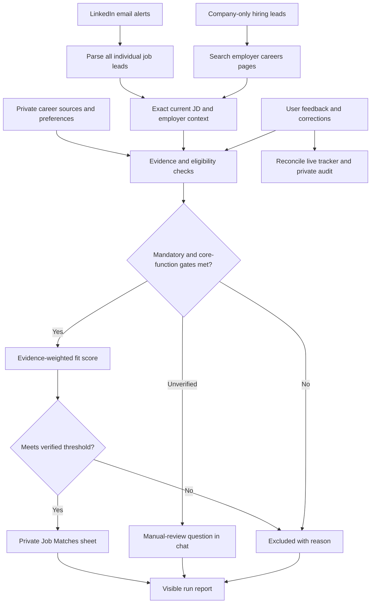

# Workflow and operating model

## Objective

Identify **real, currently verifiable job opportunities** that are well supported by a person's factual career record. Separate verified matches from unresolved prospects and exclusions. The system is research + evidence-based decision support, **not an auto-apply bot**, an eligibility guarantee or a promise of exhaustive job coverage.

## Architecture

## Four systems, each with a different purpose

| System | Contains | Must not be confused with |
|---|---|---|
| **ChatGPT Project** | Private factual CV, project records, project instructions, ongoing chats, on-demand evaluation | Public reusable template |
| **Gmail + LinkedIn** | Job-alert digests, company notifications, links, job IDs and timestamps | Proof of a currently open exact vacancy |
| **Google Sheets tracker** | Only verified current eligible matches (default tab `Job Matches`) | Chat-only manual review queue |
| **ChatGPT Scheduled task** | Optional recurring run instructions and external connected-app read/write actions | Guaranteed access to files attached to a ChatGPT Project |

## Core invariants

1. The individual's real fit never changes because of better CV wording.
2. A current exact employer JD outranks stale search snippets; disputed requirements must be rechecked against actual current evidence.
3. Mandatory gates and domain/functional suitability are independent: both must be satisfied before scoring.
4. Missing information is `UNVERIFIED`, not automatically `NO`; a clear established mismatch is not a reason to keep asking.
5. The default `73%` shortlist is an **internal QA heuristic** applied only after the gates; it is not a hiring probability.
6. Manual-only cases never appear in the **verified** sheet as blank-score rows.
7. When later evidence disqualifies a previously verified match, remove its entire row, preserve the private audit reasoning, and verify no duplicate remains.
8. Do not write to any account or notify/apply to an employer without authorized permission.
9. Every scheduled run visibly reports what it read, verified, skipped and actually wrote, including zero new matches.
10. External monitoring must independently obtain the current candidate primary sources; a prior conversation or a Project attachment inaccessible to tasks is not sufficient.

## Checkpoints

**P0 — privacy baseline:** user-owned private Project, explicit current source list, no sensitive information in public repo.  
**P1 — manual pipeline:** preferences established, at least one exact JD evidence mapped, manual vs verified separation understood.  
**P2 — tracker:** private sheet created, access and number formatting confirmed, write/readback tested.  
**P3 — inbox:** Gmail sender patterns verified against actual messages, job digests parsed end to end and deduplicated.  
**P4 — automated:** task created, enabled state and schedule confirmed, independent source access checked in a run, tracker and run report read back.

Users may stop at P1/P2 and run on demand; unattended scheduling is optional.
